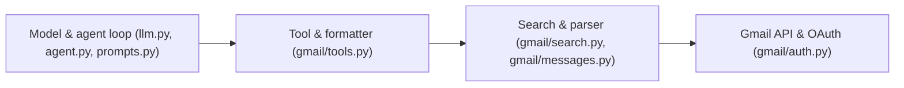

# personal-assistant

A modular, local-first personal AI assistant that runs a local LLM through Ollama by default, designed with human-in-the-loop approval as a core safety goal as write capabilities are added.

**Status:** Early development (Phase 1). Read-only Gmail search, OAuth login, typed configuration, and the core tool-calling loop are built; no CLI, approval gate, or write actions exist yet.

## Why this project exists

I am building `personal-assistant` from scratch to learn Python engineering, agentic AI patterns, and system design by working through a tool I plan to use myself. It runs a local LLM through Ollama by default, with a planned fallback to cloud models.

Human-in-the-loop approval for actions with side effects is a core design goal, but the approval gate is not built yet. Today, the only protection against unwanted side effects is that the sole tool (`search_gmail`) and the OAuth scope (`gmail.readonly`) are strictly read-only.

Objectives:

1. **Learn agentic patterns properly:** tool binding, the tool-calling loop, state machines (LangGraph), memory, and routing.
2. **Practise production-grade Python:** `src` layout, strict static typing (`mypy`), linting and formatting (`ruff`), typed configuration (`pydantic-settings`), isolated environments (`uv`), and automated tests (`pytest`).
3. **Design for safety first:** least-privilege access, the model proposes and Python code decides, email content treated as untrusted input, and limits enforced in code.
4. **Keep it local-first:** private data stays on the local machine unless a cloud provider is explicitly enabled later.

## Status and roadmap

Each item uses one of three states: **Built**, **In progress**, or **Planned**. Features without implementation in `src/` are marked **Planned**.

| Phase | Feature | Status | Notes |
| --- | --- | --- | --- |
| Core | Typed settings from env vars and `.env` | Built | `ASSISTANT_*` prefix; `Settings.db_path` is defined ahead of SQLite storage |
| Core | LLM factory (Ollama) | Built | `openai` and `anthropic` raise `NotImplementedError` |
| Core | Tool-calling loop | Built | Step limit (`max_steps=5`), unknown-tool handling, tool errors returned as messages |
| Core | Date-aware system prompt builder | Built | Injects today's date and numbered rules |
| Core | Offline unit tests | Built | 37 tests using `FakeLLM`, mocked Gmail service, and `tmp_path` |
| Core | CLI entrypoint | Planned | `personal_assistant.main` is still a placeholder |
| Core | SQLite action log | Planned | No implementation yet (only `Settings.db_path` exists) |
| Core | Approval gate | Planned | No implementation yet |
| Core | LangGraph migration | Planned | — |
| Core | Cloud providers (OpenAI, Anthropic) | Planned | — |
| Phase 1: Email (read, search, draft) via the Gmail API | Gmail OAuth login (desktop flow, token refresh) | Built | `gmail.readonly` scope; saves token with `0o600` permissions |
| Phase 1: Email (read, search, draft) via the Gmail API | Gmail search tool (`search_gmail`) | Built | Query, result cap (`<= 25`), `days_back` filter (`<= 365`), one-line metadata output |
| Phase 1: Email (read, search, draft) via the Gmail API | Reading a full email body | Planned | — |
| Phase 1: Email (read, search, draft) via the Gmail API | Creating email drafts | Planned | — |
| Phase 2: Calendar scheduling and conflict checking | Calendar scheduling and conflict checking | Planned | — |
| Phase 3: Notes and personal knowledge base (Markdown/Obsidian) | Notes and personal knowledge base (Markdown/Obsidian) | Planned | — |
| Phase 4: Proactive background automation, optional MCP conversion | Proactive background automation, optional MCP conversion | Planned | — |

## Architecture

The project separates model orchestration, tool formatting, Gmail querying/parsing, and OAuth credential handling into distinct layers so the model never talks to the Gmail API directly:



Safety checks and boundaries currently implemented in each layer:

| Layer | Boundary / check |
| --- | --- |
| `prompts.py` | Advisory rules telling the model to treat email text as data rather than instructions and not to invent emails |
| `agent.py` | Caps iterations at `max_steps` (default `5`), returns an error message for unknown tools, and catches tool exceptions into `ToolMessage` responses |
| `gmail/tools.py` | Exposes only read-only `search_gmail`; collapses whitespace and newlines to one line per email; truncates sender/subject (`200` chars) and preview (`150` chars) |
| `gmail/search.py` | Clamps `max_results` to `1..25` and `days_back` to `1..365`; fetches `format="metadata"` (`Subject`, `From`, `Date`) without bodies |
| `gmail/auth.py` | Requests `gmail.readonly` scope only; writes `secrets/token.json` with `0o600` permissions |

## Design principles

These reflect what this project currently does in code and why:

- **Read-only boundary before write capabilities:** The Gmail integration requests only `https://www.googleapis.com/auth/gmail.readonly`, fetches metadata (`Subject`, `From`, `Date`) and Gmail's short snippet rather than full bodies, stores OAuth tokens with `0o600` permissions, and keeps `secrets/` and `.env` gitignored. Because the approval gate is not built yet, keeping both the tool and OAuth scope read-only is the project's only protection against unwanted side effects.
- **Limits enforced in Python code:** Rather than relying on the model to stay within bounds, the code enforces `max_steps=5` in `run_tool_loop`, clamps `max_results` (`1..25`) and `days_back` (`1..365`) in `search_emails`, and truncates formatted output (`SUBJECT_CHARS = 200`, `PREVIEW_CHARS = 150`). Separately, `llm.py` sets `temperature=0` on `ChatOllama` as a reliability setting for more repeatable tool calls, not as a safety control.
- **Advisory prompt rules vs. code-level protections:** The system prompt in `prompts.py` instructs the model to treat email content as untrusted third-party data rather than instructions. That rule is advisory only—prompt injection is not solved. The real protections live in code: read-only scope, read-only tool exposure, metadata-only fetches, output truncation, and collapsing whitespace/newlines in `_one_line` so untrusted email fields cannot inject extra result lines.
- **Offline, deterministic tests:** The test suite runs without network access, Ollama, or Google credentials by using a scripted `FakeLLM` (`test_agent.py`), a `MagicMock` Gmail service (`test_gmail_search.py`, `test_gmail_tools.py`), and `tmp_path` + `monkeypatch` for configuration and token saving. Current tests cover settings, LLM factory selection, the tool loop, prompt building, message parsing, search query/result-cap/`days_back` clamping behavior, tool formatting, and `_save_token` permissions. The interactive `get_credentials` OAuth flow is not covered by unit tests yet.

## Getting started

### Prerequisites

- Python 3.12 (`>=3.12`, see `.python-version` and `pyproject.toml`)
- [`uv`](https://docs.astral.sh/uv/)
- [Ollama](https://ollama.com/) running locally with a tool-capable model (default: `qwen2.5:7b`):

```bash
ollama pull qwen2.5:7b  # (unverified)
```

> **Windows / WSL2 tip:** If Ollama runs on Windows while this project runs inside WSL2, enable WSL2 mirrored networking so `http://localhost:11434` inside WSL2 can reach the Windows Ollama server.

### Google Cloud setup (outline)

1. Create or select a project in Google Cloud Console and enable the **Gmail API**.
2. Configure the OAuth consent screen and add your Google account as a **test user**.
3. Create an **OAuth client ID** of type **Desktop app** and download the credentials JSON.
4. Place the file at `secrets/credentials.json` (gitignored).
5. On first authentication, the app opens a local browser login requesting only `https://www.googleapis.com/auth/gmail.readonly` and writes the token to `secrets/token.json` (gitignored, `0o600` permissions).

### Install

```bash
uv sync
```

### Configure

Create an optional `.env` file in the repository root (gitignored) to override defaults using `ASSISTANT_*` environment variables. See [Configuration reference](#configuration-reference).

### Run

No CLI exists yet. The `personal-assistant` entrypoint in `pyproject.toml` currently runs a placeholder `main()` in `src/personal_assistant/__init__.py` that prints `"Hello from personal-assistant!"`.

### Test and lint

```bash
uv run pytest
uv run ruff check
uv run mypy
```

## Configuration reference

Settings are defined in `src/personal_assistant/config.py` via `pydantic-settings` and read from environment variables (with the `ASSISTANT_` prefix) and an optional `.env` file.

| Environment variable | Field | Type | Default | Derived paths / notes |
| --- | --- | --- | --- | --- |
| `ASSISTANT_LLM_PROVIDER` | `llm_provider` | `"ollama" \| "openai" \| "anthropic"` | `"ollama"` | `openai` and `anthropic` raise `NotImplementedError` |
| `ASSISTANT_OLLAMA_BASE_URL` | `ollama_base_url` | `str` | `"http://localhost:11434"` | Base URL for the local Ollama server |
| `ASSISTANT_OLLAMA_MODEL` | `ollama_model` | `str` | `"qwen2.5:7b"` | Tool-capable Ollama model name |
| `ASSISTANT_DATA_DIR` | `data_dir` | `Path` | `data` | Derives `db_path` (`<data_dir>/assistant.db`), reserved for the planned SQLite log |
| `ASSISTANT_SECRETS_DIR` | `secrets_dir` | `Path` | `secrets` | Derives `credentials_path` (`<secrets_dir>/credentials.json`) and `token_path` (`<secrets_dir>/token.json`) |

## Project structure

```text
personal-assistant/
├── .gitattributes                         # Enforces LF line endings
├── .gitignore                             # Ignores .venv, .env, secrets/, scratch/, data/, build artifacts
├── .python-version                        # Pins Python 3.12
├── pyproject.toml                         # Dependencies, uv_build config, ruff and mypy settings
├── uv.lock                                # Locked dependency versions
├── README.md                              # Project documentation
├── src/
│   └── personal_assistant/
│       ├── __init__.py                    # Placeholder main() entrypoint
│       ├── agent.py                       # Tool-calling loop with step limit and error handling
│       ├── config.py                      # Typed Settings (pydantic-settings, ASSISTANT_ prefix)
│       ├── llm.py                         # Chat model factory (Ollama implemented)
│       ├── prompts.py                     # Date-aware system prompt and numbered rules
│       └── gmail/
│           ├── __init__.py                # Package marker
│           ├── auth.py                    # OAuth desktop login, token refresh, 0o600 token save
│           ├── messages.py                # EmailSummary dataclass and metadata header parser
│           ├── search.py                  # Gmail search with result and days_back clamping
│           └── tools.py                   # search_gmail tool and one-line summary formatter
└── tests/
    ├── test_agent.py                      # Agent loop tests using FakeLLM
    ├── test_config.py                     # Settings defaults, env overrides, and validation tests
    ├── test_gmail_auth.py                 # Token file creation and 0o600 permission tests
    ├── test_gmail_messages.py             # Header parsing and snippet unescaping tests
    ├── test_gmail_search.py               # Gmail search, result-cap, and days_back clamping tests
    ├── test_gmail_tools.py                # Summary formatting, truncation, and tool output tests
    ├── test_llm.py                        # LLM factory tests
    └── test_prompts.py                    # System prompt date and rule numbering tests
```

Local runtime paths (`.env`, `secrets/credentials.json`, `secrets/token.json`, `data/`, and `scratch/`) are gitignored and not part of the committed tree.

## Known limitations

- **No CLI yet:** `personal_assistant.main` is still a placeholder; there is no runnable CLI interface yet.
- **Weekly OAuth token expiration:** While the Google Cloud OAuth app is in Testing mode, refresh tokens expire every 7 days. `get_credentials` catches `RefreshError` and falls back to browser login.
- **Small local model tool arguments:** Smaller local models (such as 7B models) sometimes choose overly narrow or unhelpful search queries and arguments.
- **Context window not set explicitly:** `ChatOllama` is initialized without an explicit `num_ctx`, so Ollama's default context window applies.
- **Search result cap and metadata only:** `search_gmail` returns at most 25 results per call (`MAX_RESULTS_CAP = 25`) and includes headers plus short snippets only—full email bodies cannot be read yet.
- **Ollama only:** `openai` and `anthropic` are accepted by `Settings`, but `get_chat_model` raises `NotImplementedError` for both.
- **Untested OAuth flow:** The interactive login and refresh flow in `get_credentials` is not covered by unit tests yet (only `_save_token` is tested).
- **POSIX token permissions:** `_save_token` uses `chmod(0o600)`, which assumes POSIX file permission semantics.

## Development workflow

### Running tests and quality checks

```bash
uv run pytest
uv run ruff check
uv run mypy
```

Tool configuration in `pyproject.toml`:

- **ruff:** target Python 3.12, line length `100`, LF line endings, lint rules `E`, `F`, `I`, `B`, `UP`.
- **mypy:** `strict = true` on `src/` (Python 3.12), with overrides ignoring missing imports for `google_auth_oauthlib.*` and relaxing `disallow_untyped_calls` in `personal_assistant.gmail.*`.

### Commit style

Commits start with a gitmoji shortcode followed by a short imperative summary, keeping changes small and separated by concern (for example, committing implementation and tests separately):

- `:sparkles:` new features
- `:white_check_mark:` tests
- `:wrench:` configuration and tooling
- `:art:` formatting
- `:heavy_plus_sign:` adding dependencies
- `:see_no_evil:` `.gitignore` updates
- `:memo:` documentation and metadata
